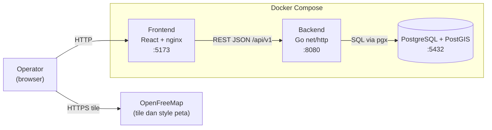
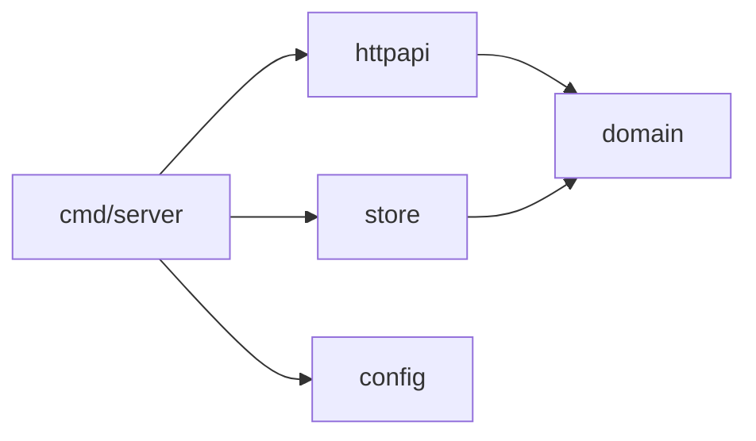
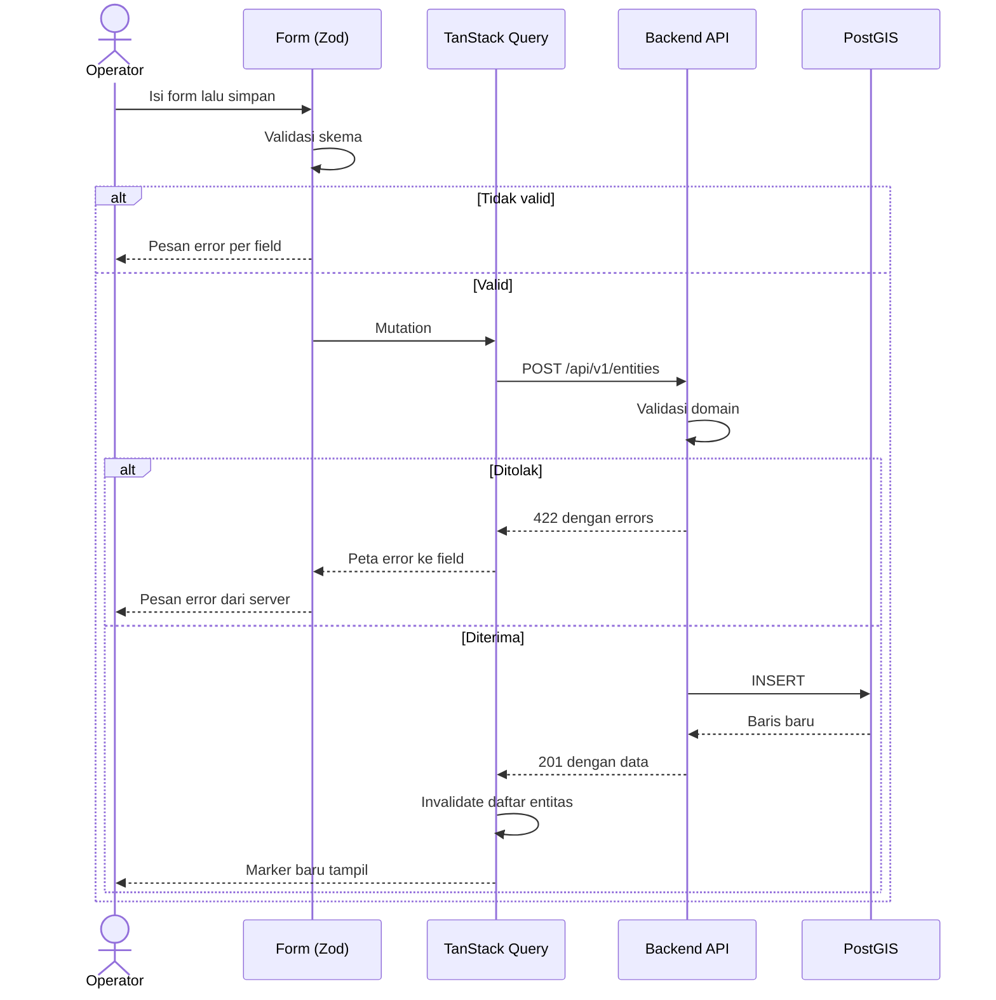

# Architecture

Status: rancangan untuk implementasi. Kode aplikasi belum dibuat; struktur ini dibangun mulai [US-001](user_stories/US-001.md). Struktur file rinci dan aturannya ada di [CLAUDE.md](../CLAUDE.md#struktur-backend).

## 1. Konteks sistem



Nginx di container frontend menyajikan file statis dan meneruskan `/api/` ke backend, sehingga browser hanya berkomunikasi dengan satu origin saat berjalan di Compose.

Pada pengembangan lokal, Vite dev server meneruskan `/api/` ke `localhost:8080`. CORS allowlist hanya diperlukan bila frontend diakses langsung dari origin lain.

## 2. Struktur repository

```text
.
├── .claude/               # Skill, command, dan pengaturan Claude Code (di-commit)
├── .github/               # Workflow CI dan autofix, template PR
├── backend/
│   ├── cmd/server/        # Entry point
│   ├── internal/
│   │   ├── config/        # Konfigurasi dari environment
│   │   ├── domain/        # Entity, enum, aturan validasi
│   │   ├── httpapi/       # Handler, middleware, envelope
│   │   └── store/         # Query PostgreSQL
│   └── migrations/        # File SQL goose (di-embed)
├── frontend/
│   ├── src/
│   │   ├── api/           # Klien HTTP dan tipe envelope
│   │   ├── features/entities/
│   │   │   ├── components/   # Form, panel detail, filter
│   │   │   ├── map/          # Peta dan marker
│   │   │   ├── hooks.ts      # Hook TanStack Query
│   │   │   └── schema.ts     # Skema Zod
│   │   └── components/ui/    # Komponen dasar
│   └── e2e/               # Test Playwright
├── docs/                  # Dokumen proyek
├── openspec/              # Spesifikasi dan change OpenSpec
├── postman/               # Koleksi uji kontrak
├── docker-compose.yml
├── .env.example
├── CHANGELOG.md
├── CLAUDE.md
└── README.md
```

## 3. Backend

Dependensi mengarah ke dalam: `httpapi` dan `store` bergantung pada `domain`, sedangkan `domain` tidak bergantung pada keduanya.



`httpapi` mendefinisikan interface `EntityStore` yang dipenuhi oleh `store`. Dengan begitu handler bisa diuji tanpa database.

**Urutan middleware:** recover → request ID → logging → security headers → CORS → batas ukuran body.

**Keputusan implementasi**

- Decoder JSON memakai `DisallowUnknownFields`.
- Latitude dan longitude didekode ke `*float64`, sehingga nilai kosong dapat dibedakan dari `0`.
- Body dibatasi 64 KiB dengan `http.MaxBytesReader`.
- Server memakai timeout baca dan tulis serta graceful shutdown pada `SIGINT` dan `SIGTERM`.
- Migrasi dijalankan saat server start.

## 4. Frontend

| Jenis state | Tempat | Contoh |
|---|---|---|
| Server state | TanStack Query | Daftar dan detail entitas |
| Form state | React Hook Form | Isi form |
| UI state | `useState` di `EntitiesPage` | Entitas terpilih, mode panel, titik yang dipilih |
| State yang bisa dibagikan | URL search params | Filter jenis dan status |

**Alur data**



**Keamanan rendering:** popup peta dirender sebagai komponen React. `setHTML` dan `dangerouslySetInnerHTML` tidak boleh dipakai untuk data entitas.

**Pemuatan data peta:** frontend mengirim batas area peta sebagai `bbox` setelah pergerakan peta selesai, dengan debounce 300 ms dan `per_page=500`. Bila `meta.total` melebihi jumlah yang dimuat, UI meminta pengguna memperbesar peta.

## 5. Konfigurasi

Semua konfigurasi berasal dari environment. `.env` tidak di-commit; contohnya ada di `.env.example`. Daftar variabel dan aturannya ada di [CLAUDE.md](../CLAUDE.md#environment).

## 6. Strategi pengujian

| Level | Alat | Cakupan |
|---|---|---|
| Unit backend | `go test` | Validasi domain, handler dengan store palsu |
| Integrasi backend | `go test` + PostGIS | Migrasi, query, filter, `bbox` |
| Kontrak API | Postman CLI + koleksi di `postman/` | Envelope dan kode status terhadap server yang berjalan |
| Unit frontend | Vitest + Testing Library | Skema Zod, form, klien API |
| End-to-end | Playwright | Alur tambah, lihat, ubah, hapus di browser |

Test integrasi membaca `TEST_DATABASE_URL` dan dilewati bila variabel itu kosong. CI selalu menyetelnya. Sebagai pengaman, test gagal bila nama database tidak berakhiran `_test`. Aturan rincinya ada di [CLAUDE.md](../CLAUDE.md#pengujian).

## 7. Keamanan

Peninjauan awal terhadap OWASP Top 10. Implementasinya wajib diverifikasi saat kode ditulis.

| Risiko | Penanganan |
|---|---|
| Broken Access Control | **Belum ditangani.** Tidak ada autentikasi ([PRD §7](PRD.md#7-di-luar-ruang-lingkup)); hanya untuk pemakaian lokal |
| Cryptographic Failures | Tidak ada data sensitif; TLS di luar ruang lingkup lokal |
| Injection | Query SQL berparameter; output dirender oleh React |
| Insecure Design | Batas ukuran body, batas `per_page`, batas jumlah atribut |
| Security Misconfiguration | CORS allowlist, security headers, pesan error tanpa detail internal |
| Vulnerable Components | `govulncheck`, `npm audit`, Dependabot |
| Authentication Failures | Tidak berlaku selama autentikasi di luar ruang lingkup |
| Data Integrity Failures | Lockfile di-commit, GitHub Actions dikunci ke commit SHA |
| Logging Failures | Log terstruktur dengan request ID, tanpa isi body |
| SSRF | Backend tidak mengambil URL dari input pengguna |
