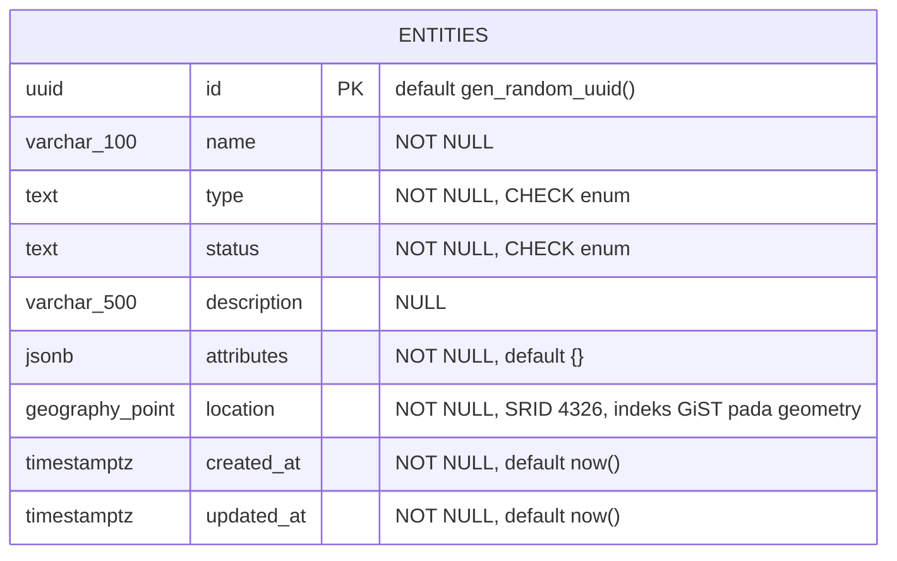

# ERD — Entity Relationship Diagram

Kebutuhan saat ini hanya memerlukan satu tabel bisnis, `entities`. Karena itu ERD tidak memiliki relasi antartabel. Alasan dan definisi kolomnya ada di [DATABASE](DATABASE.md).

`goose_db_version` adalah tabel internal goose untuk mencatat migrasi, sehingga tidak ditampilkan sebagai bagian dari model bisnis.
