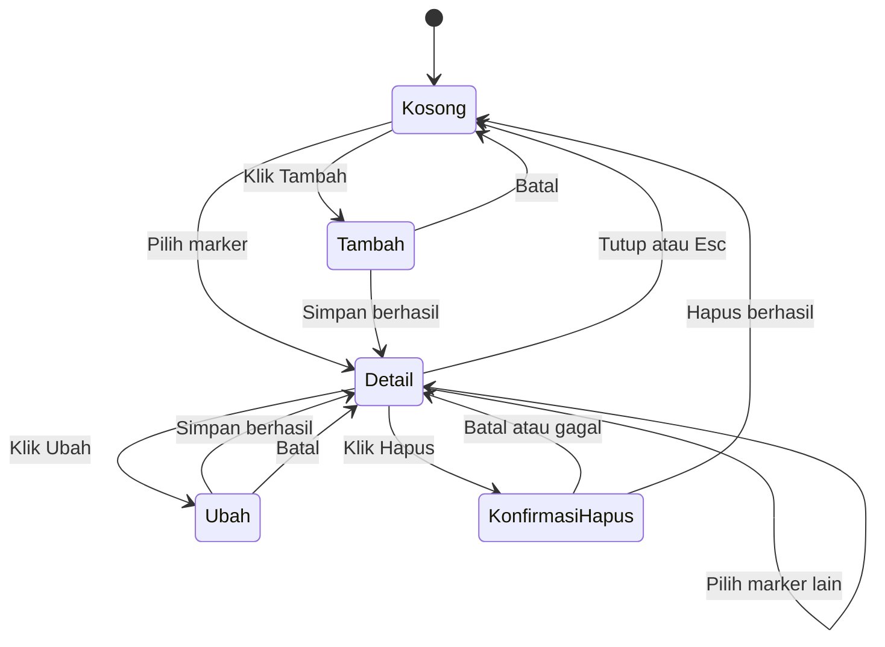

# Prototype

Dokumen ini berisi wireframe low-fidelity dan alur layar sebagai acuan implementasi. Tampilan akhir mengikuti [DESIGN_SYSTEM](DESIGN_SYSTEM.md).

## 1. Layar utama

Aplikasi memiliki satu halaman. Peta menjadi fokus, dan panel samping berganti isi menurut mode.

```text
┌──────────────────────────────────────────────────────────────────────┐
│ GeoEntity Manager        [Jenis ▾] [Status ▾] [Reset]  [+ Tambah]    │
├───────────────────────────────────────────────┬──────────────────────┤
│                                               │ Truk Logistik 01  ✕  │
│                                               │ ● Aktif · Kendaraan  │
│        ▣                                      │                      │
│                   ◉                           │ Deskripsi            │
│                                               │ Armada area Bandung  │
│                            ▲                  │                      │
│    ◉                                          │ Koordinat            │
│                                               │ -6.91750, 107.61910  │
│                  ▣                            │                      │
│                                               │ Atribut              │
│  [+]                                          │ plate_number: D 1234 │
│  [-]                                          │                      │
│                                               │ [Ubah]      [Hapus]  │
│                        © OpenFreeMap © OSM    │                      │
└───────────────────────────────────────────────┴──────────────────────┘
  ▣ Kendaraan   ◉ Perangkat IoT   ▲ Fasilitas      Warna = status
```

## 2. Form tambah atau ubah

```text
┌──────────────────────┐
│ Tambah entitas     ✕ │
│                      │
│ ⓘ Klik peta untuk    │
│   memilih lokasi     │
│                      │
│ Nama *               │
│ [__________________] │
│ Jenis *              │
│ [Kendaraan        ▾] │
│ Status *             │
│ [Aktif            ▾] │
│ Latitude *           │
│ [-6.9175___________] │
│ Longitude *          │
│ [1000______________] │
│ ⚠ Harus antara -180  │
│   dan 180            │
│ Deskripsi            │
│ [__________________] │
│ Atribut              │
│ [key____] [value___] │
│ [+ Tambah atribut]   │
│                      │
│ [Batal]    [Simpan]  │
└──────────────────────┘
```

## 3. Konfirmasi hapus

```text
┌───────────────────────────────────┐
│ Hapus entitas?                    │
│                                   │
│ "Truk Logistik 01" akan dihapus   │
│ permanen dan tidak bisa dipulihkan│
│                                   │
│              [Batal]  [Hapus]     │
└───────────────────────────────────┘
```

## 4. Status layar

| Kondisi | Tampilan |
|---|---|
| Memuat | Indikator kecil di atas peta; peta tetap dapat dipakai |
| Kosong | Kartu "Belum ada entitas" dengan tombol Tambah |
| Gagal memuat | Banner error dengan tombol Coba lagi |
| Terlalu banyak data | Banner "Perbesar peta untuk melihat semua entitas" |
| Tile gagal dimuat | Peta dasar kosong; marker dan panel tetap berfungsi |
| Layar kecil | Panel samping menjadi bottom sheet |

## 5. Alur panel


