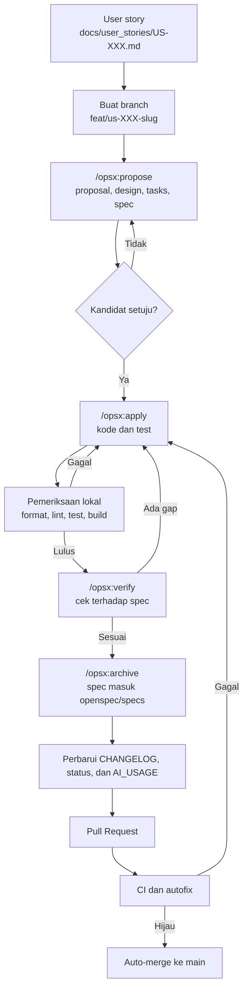

# Workflow

Dokumen ini menjelaskan cara kerja dari kebutuhan sampai kode masuk ke `main`, serta pembagian peran antara kandidat dan Claude Code.

## 1. Alur per user story

## 2. Pembagian peran

| Langkah | Claude Code | Kandidat |
|---|---|---|
| Kebutuhan | Menyusun draf dokumen | Menentukan arah dan menyetujui |
| Keputusan teknis | Mengusulkan, mengecek kompatibilitas | Memutuskan |
| Proposal OpenSpec | Menulis | **Menyetujui sebelum implementasi** |
| Kode dan test | Menulis dan menjalankan | Meninjau hasil |
| Commit, push, dan PR | Menjalankan bila diminta | Meminta dan meninjau |
| Merge | Mengaktifkan auto-merge pada PR | Dapat meninjau PR kapan saja; tanpa approval wajib |
| Pengiriman hasil | Tidak melakukan | **Memutuskan dan menjalankan** |

## 3. OpenSpec

OpenSpec memastikan perilaku disepakati sebelum kode ditulis. Skill terpasang di `.claude/skills/`, dan command di `.claude/commands/opsx/`.

| Command | Fungsi |
|---|---|
| `/opsx:explore` | Menggali masalah sebelum membuat proposal |
| `/opsx:propose` | Membuat change beserta seluruh artefak |
| `/opsx:apply` | Mengerjakan task dari change |
| `/opsx:verify` | Memeriksa kesesuaian kode dengan artefak |
| `/opsx:archive` | Memindahkan change selesai ke arsip dan memperbarui spec |

Lokasi file:

- `openspec/changes/<nama>/`: change yang sedang berjalan.
- `openspec/changes/archive/`: change yang selesai.
- `openspec/specs/`: spesifikasi perilaku terkini.

Hubungannya dengan `docs/`: dokumen di `docs/` menjawab **apa dan mengapa** di tingkat proyek, sedangkan OpenSpec menjawab **perubahan apa yang dikerjakan** pada satu user story.

## 4. Git

- `main` diproteksi dan hanya berubah lewat Pull Request. Pengecualiannya adalah commit awal repository.
- PR wajib lulus `CI success`, lalu masuk otomatis lewat auto-merge. Review tidak wajib, sesuai keputusan kandidat untuk mengejar tenggat.
- Nama branch: `feat/us-XXX-slug`, `fix/slug`, `docs/slug`, atau `chore/slug`.
- Format commit ada di [CLAUDE.md](../CLAUDE.md#git).

## 5. CI

Workflow [`ci.yml`](../.github/workflows/ci.yml) berjalan pada setiap Pull Request, push ke `main`, dan pemanggilan manual.

| Job | Isi | Berjalan bila |
|---|---|---|
| `docs` | Lint OpenAPI, validasi OpenSpec, lint workflow | Selalu |
| `changelog` | Memastikan `CHANGELOG.md` berubah | Pull Request, kecuali Dependabot |
| `secrets` | Gitleaks pada seluruh riwayat | Selalu |
| `backend` | `gofmt`, `go vet`, golangci-lint, test dengan PostGIS, govulncheck, build | `backend/go.mod` ada |
| `frontend` | Prettier, ESLint, typecheck, Vitest, build, `npm audit` | `frontend/package.json` ada |
| `e2e` | Compose dan Playwright | `frontend/playwright.config.ts` ada |
| `ci-success` | Menggabungkan hasil; job ini yang dijadikan required check | Selalu |

Job backend, frontend, dan e2e dilewati selama kodenya belum ada, lalu aktif sendiri setelah US-001 tanpa perubahan workflow.

## 6. Autofix

Ada dua mekanisme yang saling melengkapi.

**a. Workflow [`autofix.yml`](../.github/workflows/autofix.yml)** memperbaiki hal yang bersifat mekanis pada Pull Request: `gofmt`, `go mod tidy`, Prettier, dan `eslint --fix`. Bila ada perubahan, workflow membuat commit `style: apply automatic formatting` dan memicu ulang CI.

Batasannya:

- Hanya berjalan untuk branch di repository ini, tidak untuk fork.
- Tidak mengubah logika, dan tidak memperbaiki test yang gagal.
- Commit dari `GITHUB_TOKEN` tidak memicu workflow, sehingga mencegah perulangan. CI dipicu lewat `workflow_dispatch`, yang hanya tersedia setelah `ci.yml` berada di `main`.

**b. Auto-fix di Claude Code desktop** dapat diaktifkan per sesi untuk memantau PR. Claude dibangunkan saat CI gagal atau ada komentar review, lalu memperbaikinya. Ini fitur aplikasi, bukan file di repository, dan tetap ditinjau kandidat.

## 7. Saat menemukan masalah

1. Reproduksi masalah dan cari akar penyebabnya.
2. Tulis test yang gagal, lalu perbaiki.
3. Bila masalahnya penting, catat di [`docs/issue/`](issue/README.md).
4. Bila hasil AI yang keliru, catat juga di [AI_USAGE](AI_USAGE.md).

## 8. Menambah keputusan teknis

Tulis ADR baru di [`docs/adr/`](adr/) bila keputusan sulit dibalik atau memengaruhi banyak bagian. Keputusan kecil cukup dicatat di [ITA](ITA.md).

## 9. Menelusuri perubahan

Setiap perubahan wajib dicatat di [CHANGELOG](../CHANGELOG.md), dengan format pada [CLAUDE.md](../CLAUDE.md#changelog). Jejak satu fitur dapat diikuti seperti berikut:

| Pertanyaan | Tempat |
|---|---|
| Mengapa fitur ini ada? | User story di `docs/user_stories/` dan ID kebutuhan di PRD |
| Perilaku apa yang disepakati? | `openspec/specs/` dan arsip change di `openspec/changes/archive/` |
| Apa yang berubah dan bagaimana? | `CHANGELOG.md` |
| Baris kode mana yang berubah? | Pull Request dan `git log` |
| Bagaimana membuktikannya? | Bagian **Pengujian** pada changelog dan hasil CI |
| Apa peran AI? | `docs/AI_USAGE.md` |
